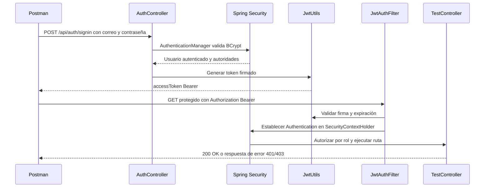

# Laboratorio 09 — Autenticación JWT

## Objetivo

Implementar una API REST con Spring Boot que registre cuentas, autentique credenciales, emita tokens JWT y limite rutas según los roles `USER`, `ADMIN` y `MODERATOR`.

## Cómo se logró

La aplicación persiste usuarios y roles mediante Spring Data JPA en MySQL de XAMPP. BCrypt guarda las contraseñas como hashes. Al iniciar sesión, `AuthenticationManager` valida el correo y la contraseña; `JwtUtils` crea un token firmado que `JwtAuthFilter` valida en las siguientes peticiones. `SecurityFilterChain` no mantiene sesión y aplica los permisos a cada ruta.

El registro público asigna únicamente `USER`. Las cuentas `ADMIN` y `MODERATOR` se crean de forma local al iniciar por primera vez; así el formulario abierto no permite que una persona se eleve sus propios permisos.

## Herramientas y versiones

- Java 17, Spring Boot 3.4.5 y Maven Wrapper.
- Spring Web, Spring Data JPA, Hibernate, Spring Security y Bean Validation.
- MySQL Connector/J y JJWT 0.11.5.
- XAMPP con MariaDB/MySQL local en `localhost:3306`.
- Visual Studio Code y Postman.

## Base de datos

La aplicación usa `security_db`. El parámetro `createDatabaseIfNotExist=true` permite que Connector/J la cree al conectar si el usuario de MySQL tiene permiso. Como alternativa, en phpMyAdmin ejecuta:

```sql
CREATE DATABASE IF NOT EXISTS security_db
    CHARACTER SET utf8mb4
    COLLATE utf8mb4_unicode_ci;
```

El script está en `database/create_security_db.sql`. Hibernate crea o actualiza `roles`, `users` y `user_roles` al arrancar. `DataInitializer` inserta los tres roles y tres cuentas de demostración solamente si no existen.

## Ejecución en Windows

1. En XAMPP, inicia **MySQL**. Apache solo se necesita para abrir phpMyAdmin.
2. Abre `lab09-jwt-security` en Visual Studio Code.
3. Revisa `src/main/resources/application.properties`. La configuración local usa `root` sin contraseña. Si tu instalación tiene otra clave, define `DB_USERNAME` y `DB_PASSWORD`.
4. En la terminal integrada ejecuta:

   ```powershell
   .\mvnw.cmd spring-boot:run
   ```

5. Espera el mensaje de inicio y usa `http://localhost:8080` como dirección base.

La clave JWT de `application.properties` es de demostración. Para cambiarla, define `JWT_SECRET_BASE64` con una clave Base64 de al menos 32 bytes. No reutilices la clave de ejemplo en un despliegue real.

## Cuentas de demostración

| Correo | Contraseña | Rol |
|---|---|---|
| `admin@test.com` | `Admin@S09` | `ROLE_ADMIN` |
| `user@test.com` | `User@S09` | `ROLE_USER` |
| `moderator@test.com` | `Mod@S09` | `ROLE_MODERATOR` |

Las cuentas se crean solo si no existe ya el correo; cambiar las contraseñas en las propiedades de entorno no actualiza las cuentas existentes. La aplicación guarda las contraseñas con BCrypt.

## Endpoints principales

| Método | Ruta | Acceso | Resultado esperado |
|---|---|---|---|
| `POST` | `/api/auth/signup` | Público | `201` para registro normal; `400` si solicita un rol elevado |
| `POST` | `/api/auth/signin` | Público | `200` y objeto con token Bearer; `401` credenciales incorrectas |
| `GET` | `/api/test/all` | Público | `200` |
| `GET` | `/api/test/user` | `USER` o `ADMIN` | `200`, `401` sin token, `403` sin rol |
| `GET` | `/api/test/admin` | `ADMIN` | `200`, `401` sin token, `403` sin rol |
| `GET` | `/api/test/mod` | `MODERATOR` | `200`, `401` sin token, `403` sin rol |

## Flujo de autenticación



## Pruebas en Postman

Importa `postman/Lab09-JWT.postman_collection.json`. La colección contiene registro, login y solicitudes para los seis escenarios solicitados:

1. Ruta pública `/api/test/all` sin token: `200`.
2. Ruta protegida `/api/test/user` sin token: `401`.
3. Token alterado en ruta protegida: `401`.
4. Token válido de `USER` para `/api/test/user`: `200`.
5. Token válido de `USER` para `/api/test/admin`: `403`.
6. Token válido de `ADMIN` para `/api/test/admin`: `200`.

La colección también verifica que un login con contraseña incorrecta responda `401` y que el registro rechace una petición que solicite ADMIN. Los requests de login de administrador, usuario y moderador guardan sus tokens en variables locales. Si el registro se ejecuta más de una vez, el segundo intento devolverá `409` por correo duplicado.

## Observaciones

1. La autenticación JWT es sin estado: cada ruta privada recibe su token en la cabecera `Authorization`.
2. La firma y la expiración se verifican en cada petición protegida.
3. `401` indica falta de autenticación o token inválido; `403` indica que el rol autenticado no tiene permiso.
4. El rol `USER` se asigna automáticamente durante el registro público.
5. Los roles privilegiados y sus cuentas de demostración se cargan al iniciar solo si aún no existen.

## Conclusiones

1. Separé la autenticación, que confirma la identidad, de la autorización, que limita las rutas por rol.
2. El token firmado permite identificar al usuario sin guardar una sesión en el servidor.
3. BCrypt evita guardar las contraseñas en texto legible en MySQL.
4. La relación muchos a muchos permite asociar a un usuario con uno o más roles.
5. Las pruebas por escenarios en Postman ayudan a comprobar tanto las rutas permitidas como los rechazos `401` y `403`.
