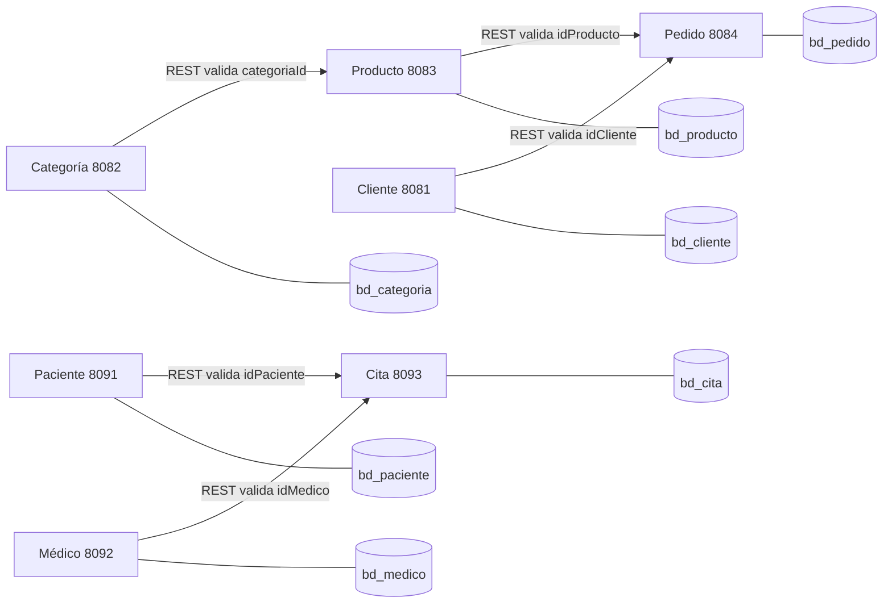

# Laboratorio 11 — Microservicios con Spring Boot

**Curso:** Desarrollo de Aplicaciones Web  
**Sección:** C24-D  
**Estudiante:** Jesús Castillo Sumire

Este laboratorio está organizado en dos bloques que aparecen en la guía: el ejercicio de tienda (categorías, clientes, productos y pedidos) y la actividad final de gestión de citas médicas (pacientes, médicos y citas). Cada bloque contiene proyectos Spring Boot independientes, con arquitectura por capas, base de datos propia y puerto separado.

## Estructura

```text
microservicios/
├── categoria-service/   # Ejercicio guía; puerto 8082
├── cliente-service/     # Ejercicio guía; puerto 8081
├── producto-service/    # Ejercicio guía; puerto 8083; consume Categoría
├── pedido-service/      # Ejercicio guía; puerto 8084; consume Cliente y Producto
├── paciente-service/    # Actividad clínica; puerto 8091
├── medico-service/      # Actividad clínica; puerto 8092
├── cita-service/        # Actividad clínica; puerto 8093; consume Paciente y Médico
├── database/            # Creación de bases y esquema SQL de la clínica
└── postman/             # Colección de solicitudes de verificación
```

## Preparación

1. Iniciar MySQL desde XAMPP y confirmar que escucha en el puerto `3306`.
2. Ejecutar `microservicios/database/create-databases.sql` en phpMyAdmin. Las bases de desarrollo (`*_dev`) se crean automáticamente si el usuario MySQL tiene permiso `CREATE DATABASE`.
3. Cada servicio usa por defecto el perfil `dev`, el usuario `root` y contraseña vacía. Si tu instalación tiene otra contraseña, establece `DB_USER` y `DB_PASSWORD` antes de ejecutarlo.
4. En cada proyecto abre una terminal de VS Code en su carpeta y ejecuta:

```powershell
./mvnw.cmd spring-boot:run
```

Inicia cada servicio en una terminal distinta. Para producción local puedes seleccionar el perfil `prod` con `$env:PROFILE_ACTIVE='prod'` antes de ejecutar. Para cambiar el puerto, usa `$env:SERVER_PORT='PUERTO'`. Para otras conexiones define `DB_URL`, `DB_USER` y `DB_PASSWORD`.

## Flujo entre servicios



Las referencias entre microservicios se guardan como identificadores. No se crean claves foráneas entre bases distintas; el servicio consumidor confirma la existencia mediante HTTP. En el microservicio de citas, `Atencion` sí mantiene una relación local uno a uno con `Cita`.

## Endpoints principales

| Servicio | Puerto | Rutas |
|---|---:|---|
| Categoría | 8082 | `/api/categorias` y `/api/categorias/{id}` |
| Cliente | 8081 | `/api/clientes` y `/api/clientes/{id}` |
| Producto | 8083 | `/api/productos` y `/api/productos/{id}` |
| Pedido | 8084 | `/api/pedidos` y `/api/pedidos/{id}` |
| Paciente | 8091 | `/api/pacientes` y `/api/pacientes/{id}` |
| Médico | 8092 | `/api/especialidades`, `/api/medicos`, `/api/horarios` |
| Cita | 8093 | `/api/citas`, `/api/citas/{id}/estado`, `/cancelar`, `/atencion` |

Las operaciones CRUD devuelven `200`, `201` o `204`; recursos inexistentes producen `404`, datos inválidos `400`, y no se registra atención para una cita cancelada (`409`). La validación de referencias remotas también responde `400` cuando el ID no existe o el otro servicio no está disponible.

## Orden sugerido para las pruebas

1. Registrar una categoría; luego crear un producto usando su ID.
2. Registrar un cliente; después crear un pedido usando IDs de cliente y productos existentes.
3. Registrar un paciente y una especialidad; crear un médico asociado a esa especialidad.
4. Crear una cita usando paciente y médico existentes, actualizar el estado, registrar la atención y consultar la atención.
5. Probar IDs inexistentes, correo/documento inválido, estado no permitido y las rutas para recursos que no existan.

La colección de Postman está en `microservicios/postman/Laboratorio-11.postman_collection.json`. Incluye flujos de ejemplo para la actividad clínica y el ejercicio de tienda; ejecútala después de iniciar MySQL y los servicios que participan en las relaciones.

## Evidencia y verificación

Los siete proyectos se compilaron con Maven usando JDK 21. No se registran respuestas HTTP ni capturas de Postman como evidencia de ejecución porque MySQL no estaba escuchando localmente durante la preparación; las pruebas de integración deben ejecutarse con XAMPP activo. El PDF de entrega está en `Documentos/Laboratorios/Semana 11/Semana 11.pdf`.
